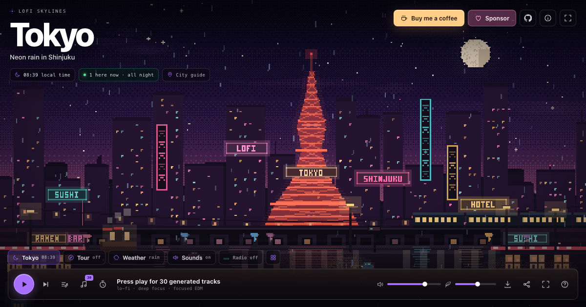

# Lofi Skylines

Pixel-art city nights with 30 generated tracks, live in your browser.
A small, free, open-source tribute to [Lofi Cities](https://loficities.com).

**Live:** <https://lofi-skylines.mrsheerluck003.workers.dev>
**Source:** <https://github.com/MrSheerluck/lofi-skylines>
**Buy me a coffee:** <https://buymeacoffee.com/mrsheerlucx>
**GitHub Sponsors:** <https://github.com/sponsors/MrSheerluck>

Fourteen hand-built scenes — Tokyo, Paris, New York, London, Seoul, Rio,
Istanbul, Cairo, Singapore, Sydney, Amsterdam, Bangkok, Dubai and Hong Kong —
each drawn pixel by pixel on a 480 × 270 canvas. The music is synthesized with
the Web Audio API; the rain ambience and thunder strikes are recorded samples.
No streams, no account, no ads.



## What's inside

- **Fourteen animated pixel cities** with rain, snow, fog, clouds, traffic,
  trains, pedestrians, birds, blinking signs, reflections, and falling leaves.
- **A 30-track library in three moods:** ten lo-fi tracks, ten deep-focus
  tracks, and ten focused-EDM tracks. Every track has its own tempo, key
  transposition, chord progression, melody density, and drum recipe.
- **Real synthesis, not samples:** Rhodes chords, felt piano, pads, synth
  stabs, arpeggios, bass, drums and weather transitions are scheduled live with
  the Web Audio API. Recorded rain and thunder samples provide the weather bed.
- **A real playlist:** Next plays the next track immediately, auto-advance
  keeps the current mood, and the library lets you jump to any of the 30.
- **Seven weather sound beds:** rain, storm, snow, breeze, autumn, fog and a
  clear night. Every storm thunder event uses the same recorded strike at a
  consistent level, while distance changes when the thunder arrives. The rain
  bed ducks beneath it. Snow brings wind and hush, autumn rustles, fog muffles
  the city, and clear nights get a low hum and crickets. Weather changes
  crossfade the ambience and add a short transition.
- **A cycling weather chip** — click it or press `W` to step through all seven
  weathers with their scenes and sounds.
- **A cycling city chip** — click it to move through all six cities one by one,
  or open the City picker for previews and local times.
- **City tour**, a 25/50-minute focus timer, keyboard shortcuts, volume
  controls, shareable city links, and a downloadable 1920 × 1080 postcard.
- **No build step, no tracking, no third-party requests.** The site is plain
  HTML, CSS, ES modules, Canvas, and Web Audio.

## Run locally

```sh
npm install
npm run dev
```

Open the URL Wrangler prints (usually <http://localhost:8787>). Audio starts on
the first click, as browsers require.

You can also use any static file server:

```sh
python3 -m http.server 8899 --directory public
```

## Deploy to Cloudflare (free)

This repo is set up for **Cloudflare Workers static assets**, which is free for
this kind of site and gives you a `*.workers.dev` URL plus optional custom
domains.

```sh
npx wrangler login
npm run deploy
```

`wrangler.jsonc` serves everything in `public/` and falls back to
`index.html` for unknown paths. No Worker script is needed. The first deploy
asks you to create a Workers subdomain if you do not have one.

### Deploy from the dashboard

1. Push this repository to GitHub.
2. In Cloudflare, go to **Workers & Pages → Create → Workers → Connect to Git**.
3. Pick the repository.
4. Leave the build command empty and set the deploy command to `npx wrangler deploy`.
5. Deploy. Future pushes can redeploy automatically.

Alternatively, create a **Pages** project from the repo with no build command
and `public` as the output directory.

### Custom domain

In the Cloudflare dashboard, open the deployed Worker → **Settings → Domains &
Routes → Add custom domain**. Any domain on your Cloudflare account works over
HTTPS for free.

## Make it yours

| File | What to change |
| --- | --- |
| `public/index.html` | Copy, links, meta tags, and the GitHub URL. |
| `public/styles.css` | Colors, type, spacing, and the UI accent. |
| `public/js/cities.js` | City names, subtitles, time zones, guides, accents. |
| `public/js/scenes.js` | Canvas art and animation per city. |
| `public/js/catalog.js` | The 30 tracks, their categories, tempos, keys, and recipes. |
| `public/js/titles.js` | Style labels and voice descriptions. |
| `public/js/audio.js` | Chord progressions, instruments, ambience, and mixes. |

The GitHub links in `index.html` point at this repository. If you fork the
project, update them to point at your fork.

### Adding a track

Add a row to the matching category in `public/js/catalog.js`:

```js
["Track title", "jazzhop", progressionIndex, transpose, bpm, swing, density, octave]
```

Use `catalog.js` categories to keep the 10/10/10 split, or change it. The
engine reads the recipe automatically when the track is selected.

### Adding a city

1. Add a city entry to `CITIES` in `public/js/cities.js`.
2. Add a palette in `SKY_DEFS` in `public/js/scenes.js`.
3. Write a `drawYourCity(ctx, t, weather, reducedMotion)` function and add it
   to the dispatcher in `drawScene`.

Everything else — the picker, deep links, local time, tour, weather, and the
music library — follows automatically.

## Keyboard shortcuts

| Key | Action |
| --- | --- |
| `Space` | Play / pause |
| `N` | Next track |
| `C` | Choose a city |
| `W` | Change weather |
| `V` | Open the 30-track library |
| `T` | Focus timer |
| `F` | Fullscreen |
| `M` | Mute / unmute |
| `A` | Weather &amp; city sounds on / off |
| `1`–`9`, `0` | Jump to the first ten cities |
| `←` `→` | Previous / next city |
| `?` | Shortcuts |
| `Esc` | Close a panel |

## Notes

- Audio needs a user gesture. Click the play button once; after that the
  Web Audio graph runs until you pause it.
- `prefers-reduced-motion` freezes the scene and disables decorative motion.
- Local state (city, current track, weather, volume, sound toggle) is stored in
  `localStorage` only. There is no backend, no analytics, and no cookie.
- The site intentionally has no framework or bundler. It should run on any
  static host, not just Cloudflare.

## Support

If this helps you focus, you can keep the night running:

- [Buy me a coffee](https://buymeacoffee.com/mrsheerlucx)
- [Sponsor on GitHub](https://github.com/sponsors/MrSheerluck)

## Credit

Design inspiration: [Lofi Cities](https://loficities.com) by Safa El Mali.
This is an independent, from-scratch homage; it does not include any assets
from the original site. All pixel art in this project is drawn in code, and
the music is synthesized live.

Thunder sample: **“Thunder Strike” by Universfield**, via
[Pixabay](https://pixabay.com/sound-effects/), used under the Pixabay Content
License. Rain ambience and background thunder: **“Rain & Thunder” by
SoundReality**, via Pixabay. Both recordings live under `public/assets/`.

MIT licensed. See [LICENSE](LICENSE).
